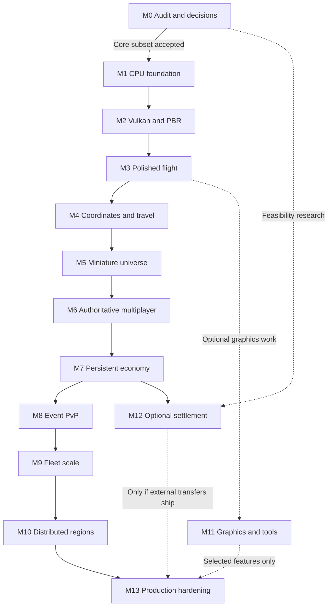

# Milestones and atomic implementation tasks

Status: proposed roadmap. M0 remains incomplete because the private NGEN checkout and raw hardware profiles are unavailable. Public-template research and this planning package do not close that gate. No engine task below has been implemented or tested in this assignment.

The delivery order is **polished offline flight, miniature offline game, authoritative multiplayer**. Commands, stable IDs, clocks, snapshots and dependency boundaries appear early. Sockets, PostgreSQL, distributed ownership and blockchain appear only when their milestones require them. This document proposes source areas; the actual checkout audit must map them to existing paths and retain working implementations.

Read [repository-audit.md](repository-audit.md) and [build-review-infrastructure.md](build-review-infrastructure.md) before executing tasks. The accepted architecture specifications and ADRs determine API details. Numbers below are proposed acceptance budgets, never measured results or player-capacity promises.

## Dependency graph

Solid edges are completion dependencies. The M0–M1 edge requires the accepted CPU foundation review subset; deferred GPU captures close by M2-A. Dashed edges identify optional work or an earlier research start. An optional branch enters a release only after its own gate passes.

| Milestone | Prerequisite for completion | Work that can proceed alongside it |
|---|---|---|
| M0 | Actual checkout/policies and CPU facts; deferred GPU capture closes by M2-A | Public-source research, asset briefs, settlement feasibility |
| M1 | Accepted M0 core review subset and separate implementation authorization | Art/reference evaluation within approved spending |
| M2 | M1 foundation; required-machine GPU capture and shader/device experiment | Asset preparation and offline gameplay specification |
| M3 | M2 renderer and asset path | M11 experiments after the flight gate passes |
| M4 | M3 flight; precision experiment accepted | Miniature-game content preparation |
| M5 | M4 travel/streaming | Multiplayer protocol specification, no premature implementation |
| M6 | M5 playable loop and headless separation | Database schema/failure-model review |
| M7 | M6 authority and command receipts | M11 graphics; M12 settlement model using accepted ledger contract |
| M8 | M7 persistence and faction identities | Fleet fixture preparation |
| M9 | M8 permission semantics and M7 economic clocks | M11 optional effects and tools |
| M10 | M9 measured regional limits | Release packaging and operations documentation |
| M11 | M3 generally; M4/M5 for tasks named below | M7–M10; never blocks core progress for an unselected feature |
| M12 | Feasibility starts after M0; implementation requires M7 and legal/security gates | Core game development; its failure does not cancel the game |
| M13 | M10 and selected release features; M12 only if external transfers ship | No unreviewed optional feature enters the release |

## Task and evidence contract

Each row is one bounded, reviewable outcome. Implement only the stated slice and its necessary tests. A minimal fixture is sufficient; it does not authorize a general framework. If the checkout already provides the outcome, verify and reuse it. If integration reveals a materially larger change, record the new dependency and split the task before implementation. Each task's dependencies include its milestone entry gate unless a narrower earlier start is explicit.

For every task, record the base/reviewed SHA, applicable policy, accepted ADR, affected paths, dependency lock, commands, environment, results and remaining limitations. Attach raw test output and the smallest reproducible fixture. Runtime evidence includes scene/input seed, build configuration, device/CPU identity, driver, clock/power state, workload counts, latency distributions, memory and relevant trace. Sanitizer or validation runs are separate from performance runs.

Milestone closure requires all task outcomes, the integrated acceptance scenario, resolved blocking findings, and a concise evidence index. An independent reviewer checks the implementation against the requirements and the evidence. Formal review and PR operations follow the actual `AGENTS.md`: signed conventional commits by `kyau`, permitted branch names, completed Test Plan, formal review by the authorized identity, and PR creation/merge by `kyaulabs-bot`. Never bypass hooks, signing or secret checks. This planning assignment authorizes none of those repository mutations.

Use the same repeatable benchmark for before/after comparisons. Do not improve results by silently reducing ship equipment, collision density, projectile count, visual settings or active clients. Changing a budget or fixture requires an explained ADR and a retained old result. A test that could not run stays blocked, not passed. All milestones inherit zero owned-code warnings, required repository checks and relevant ownership/security tests.

## M0 — Audit and accept the architecture

Deliver a verified private-repository inventory, template comparison, policy/ownership review, hardware facts, dependency candidates, accepted ADR set and first implementation scope. The public audit is a reference, not evidence of NGEN's current contents. Source areas are documentation and read-only repository/hardware inventories; isolated probes require separate authorization and must not alter infrastructure.

| Task and outcome | Dependencies | Proposed source area | Tests and completion evidence |
|---|---|---|---|
| M0-A: classify every relevant NGEN file as inherited, customized or NGEN-specific, including existing engine code | Actual checkout access | `docs/planning/repository-audit.md` | Read actual root/nested policies first; record HEAD/dirty state, focused comparisons and hashes. A second reviewer can reproduce every classification. |
| M0-B: resolve workflow and ownership gaps into a preservation/change list | M0-A | `docs/planning/`, actual hooks/rulesets/templates | Compare policy intent with active enforcement. Inventory license ownership and copied material. Record conflicting instructions without changing protections or the license. |
| M0-C: record CPU/OS/toolchain facts needed by the CPU foundation | Read-only host access | `docs/benchmarks/hardware/` | Retain CPU/RAM, OS, compiler availability and build-host limits. Track GPU JSON, driver/display path and VM GPU access as deferred M2-A evidence; their absence does not block M1. |
| M0-D: accept the CPU dependency/toolchain subset after isolated compatibility probes | M0-A, M0-C | `docs/planning/dependencies.md`, temporary probe workspace | Build minimal CPU dependency consumers on required compiler families; preserve versions, hashes, recipe options and failures. Track graphics probes for M2. No probe is an NGEN integration test. |
| M0-E: approve the M1 core review subset and enumerate remaining audit experiments | M0-B, M0-D | `docs/adr/`, `docs/planning/` | Accept actual repository/policy review, CPU graph and M1 ADRs. Verify proposed paths against the checkout. Record deferred GPU items explicitly and retain their M2-A gate. |

Performance gate: benchmark manifests identify hardware, fixture and measurement method; no runtime speed claim is required here. Missing checkout, unresolved rights, incompatible CPU dependencies or contradictory review enforcement block the core review subset. Independent acceptance of M0-A–E permits separately authorized M1 work while GPU items remain open. Overall M0 closes only when those audit items close at M2-A. **Neither the core review subset nor M0 is closed in this package.**

## M1 — Establish the CPU-only foundation

Deliver a reproducible C++20 build, meaningful tests, bounded ownership primitives, simulation command/snapshot contracts and CPU-only CI. Start with the repository's working tools if they exist. Candidate tool versions belong in the dependency decision, not scattered through task text. This milestone introduces interfaces needed by offline play; it does not implement accounts, network transport or a database.

| Task and outcome | Dependencies | Proposed source area | Tests and completion evidence |
|---|---|---|---|
| M1-A: configure the core/test targets through pinned Conan profiles and CMake presets | M0-E | Root build files, `cmake/`, `profiles/` | Clean configure/build on Linux Clang plus compatibility compilers; missing compiler/dependency gives a useful error. Retain lock, dependency graph and preset output. |
| M1-B: add strong entity/time/unit types and generation-checked handles required by the first simulation fixture | M1-A | `engine/core/`, `tests/core/` | Exercise overflow, invalid IDs, stale-handle reuse and unit conversion boundaries. Do not invent a general serialization/reflection framework. |
| M1-C: provide bounded task submission and worker shutdown around the selected scheduler | M1-A, M1-B | `engine/jobs/`, `tests/jobs/` | Saturate the queue, cancel pending work and shut down during dependencies; prove no deadlock, race or escaped task lifetime under CPU sanitizers. |
| M1-D: define and execute a minimal fixed-tick command-to-snapshot path | M1-B, M1-C | `engine/simulation/`, `tests/simulation/` | Replay a seeded entity-movement fixture; enforce command ordering and immutable publication. Repeated serial runs match; capacity exhaustion has an explicit result. |
| M1-E: make the CPU harness build and run without graphics or service dependencies | M1-D | `apps/sim_harness/`, target configuration | Resolve and run on a clean no-display environment with no Vulkan SDK. Inspect link/dependency graph; graphics leakage fails the task. |
| M1-F: integrate existing policy checks, tests, sanitizers and profiling into isolated CPU CI | M1-A–E | Actual workflow locations, `tests/`, `benchmarks/` | Required checks execute on the reviewed SHA; demonstrate a representative failure is reported. Keep TSan separate from ASan/UBSan; attach coverage and trace from meaningful core paths. |

Performance gate: the fixed fixture has bounded queues/memory and zero unexpected steady-state heap allocations after warmup. Record scheduling/tick distributions without claiming an empty harness predicts fleet capacity. Failure modes are ownership ambiguity, transitive graphics dependencies, runaway queues and toolchain inconsistency. Review the target graph and error boundaries independently; closure evidence includes clean builds, sanitizer logs, dependency manifest and replay fixture.

## M2 — Render one imported PBR spacecraft

Deliver Vulkan first light, reliable resource lifetimes, one cooked spacecraft, a fixed forward/PBR pass sequence and a small development inspector. Vulkan 1.3 is the baseline; optional capabilities must be independently queryable and force-disableable. The inspector exposes relevant state and diagnostics, not a full editor.

| Task and outcome | Dependencies | Proposed source area | Tests and completion evidence |
|---|---|---|---|
| M2-A: create the SDL window, Vulkan surface and explicit capability selection | M1-F, M0-C | `engine/platform/`, `engine/render/vulkan/` | Require physical-device JSON, driver/display path and feature evidence on each required machine before accepting its GPU tier. Test Wayland/Windows startup, missing features and zero drawable size. An unverified optional VM stays outside performance claims. |
| M2-B: add GPU buffers/images with VMA ownership and submission-based retirement | M2-A | `engine/render/vulkan/resources/` | Repeatedly replace/unload resources during in-flight work; exercise partial initialization and shutdown. Require clean synchronization/object-lifetime validation and a memory plateau. |
| M2-C: compile and validate one shader interface through the selected offline compiler | M2-A | `tools/shaderc/`, `shaders/`, `tests/shaders/` | Compile the PBR pair for the minimum profile; check reflection/layout against CPU types and SPIR-V validation on Intel/NVIDIA. Record exact compiler/library hashes. |
| M2-D: cook and load one glTF spacecraft into a versioned runtime package | M2-B | `tools/assetc/`, `engine/assets/` | Test missing files, invalid indices, oversized buffers and cancelled loads. A packaged fixture loads without a source importer or network connection. |
| M2-E: draw the ship with a fixed opaque/shadow/transparent/post/UI schedule | M2-C, M2-D | `engine/render/`, `shaders/`, sample scene | Compare reference materials and normal/color-space fixtures; use explicit pass resource declarations. Save representative images, validation logs and CPU/GPU pass timing. |
| M2-F: inspect selected render and asset state through queued development commands | M2-E | `tools/inspector/` | Selecting/reloading a resource cannot mutate an in-flight snapshot or corrupt the frame. Verify disabled tooling in a release build; record the short inspection walkthrough. |

Performance gate: meet the defined laptop lightweight-scene budget, initially 1280×720 with median ≤50 ms and P95 ≤66.7 ms after warmup. Preserve scene/settings hashes. Driver/swapchain failures, lifetime errors, shader-layout differences and unexpected source-import work on the render thread block closure. Independent graphics review examines validation, fallback behavior and captures; a triangle alone does not close M2.

## M3 — Ship the polished offline flight demonstration

Deliver one enjoyable offline flight scene with one spacecraft, assisted Newtonian motion, tactical/direct control, a usable camera, lighting/effects and audio. No login, service or Internet connection is allowed in its startup path. Content is deliberately small so polish can be judged before a galaxy is attempted.

| Task and outcome | Dependencies | Proposed source area | Tests and completion evidence |
|---|---|---|---|
| M3-A: drive one hull through a force/torque flight-assist model | M2-E | `game/flight/`, `engine/physics/` | At 60 fixed steps per simulation second, test acceleration, braking, mass changes and frame-rate independence. Preserve replay and force/velocity plots for representative maneuvers. |
| M3-B: map tactical destination/orbit intent and direct input to the same flight controller | M3-A | `game/flight/`, input command adapter | Switch modes during thrust/rotation; preserve pose and momentum. Verify controller limits and stable arrival/orbit behavior for the declared flight envelope. |
| M3-C: implement the selected flight camera with controllable focus and motion behavior | M3-A | `game/presentation/camera/` | Replay fast turns, near-obstacle flight and focus loss. Camera interpolation remains independent of simulation rate and cannot alter ship state. |
| M3-D: author the approved ship/asteroid flight presentation preset using M2 effects | M3-B, M3-C | Game scene/material/effect assets | Review silhouette, material response, shadows, exhaust and restrained post-processing on the laptop. Keep before/after captures and the approved asset/provenance manifest. |
| M3-E: add bounded flight audio cues driven by the presentation snapshot | M3-A | `game/audio/`, audio assets | Test device loss/reconnect, mute, clipping and repeated scene reset. Audio failures must not stop simulation; include a recorded full demonstration. |

Performance gate: the fixed laptop replay passes the lightweight flight target and memory caps; the specified desktop replay records its separate target. No live GPU measurement is supplied by this plan. Review control feel and presentation with Sean using the runnable artifact. Instability, visible camera judder, opaque controls or offline startup dependency fail closure even when screenshots look good. Completion evidence is the packaged offline demo, input replay, benchmark trace, audio/video capture and documented feedback decisions.

## M4 — Support astronomical travel and streaming

Deliver connected systems with security sectors, predominantly fixed celestial arrangements and orbital infrastructure; hierarchical coordinates; safe local physics frames; and committed warp with destination prefetch. Gate/wormhole routes and jump-capable ships use explicit travel permissions. Cinematic travel may conceal bounded preparation; arbitrary network/disk failure cannot be promised invisible.

| Task and outcome | Dependencies | Proposed source area | Tests and completion evidence |
|---|---|---|---|
| M4-A: implement canonical cell/offset coordinates and explicit nonrotating frame transforms | M3 acceptance, precision ADR | `engine/world/coordinates/` | Test normalization, bounds and round trips at system/interstellar distances; analytic residual ≤1 mm and velocity residual ≤0.1 mm/s in declared fixtures. |
| M4-B: transfer one local physics domain between origins at a tick barrier | M4-A | `engine/physics/`, simulation frame state | Perform 10,000 origin transfers; preserve contacts, constraints and trajectory. Test 10 m, 100 m and 1 km hull cases, with separately agreed contact tolerances. |
| M4-C: preserve rendering/prediction history across a frame-epoch change | M4-B | Render snapshot extraction, temporal state | Compare equivalent near/far-origin views; target ≤0.25-pixel difference. Check shadows, particles and motion vectors; no consumer may mix frame epochs. |
| M4-D: implement one committed warp trajectory with entry/transit/exit states | M4-A, M3-B | `game/travel/` | Test ship jump capability, route/security permission, cancellation, unavailable destination and repeated arrival commands. Exit cannot duplicate vessels or enter unavailable collision data. |
| M4-E: stream connected authored/procedural system manifests with prefetch, proxies and bounded eviction | M4-C, M4-D | `engine/assets/streaming/`, world manifests | Fix seeds, security sectors, celestial/orbital placements and gate/wormhole routes. Inject slow/missing/corrupt assets and memory pressure. Residency commits after upload; failed preparation delays arrival safely. Keep hashes and a crossing trace. |

Performance gate: preserve flight-frame targets during the fixed crossing replay, with no warmed streaming hitch above 200 ms in the declared workload. Exceeding storage capacity changes admission/prefetch policy, not the test fixture silently. Precision loss, frame-induced velocity changes, dangling assets or collision-domain splits block closure. Review physics and rendering independently, then accept a continuous two-system traversal with fault evidence.

## M5 — Complete the miniature offline universe

Deliver a deliberately bounded playable slice: two systems, one station market, one mineable resource, one starter hull, one enemy archetype, one targeted weapon and one projectile weapon. The player can mine, fight, lose a ship, salvage, dock, trade and recover. Limit content while establishing correct ownership and replay/save semantics.

| Task and outcome | Dependencies | Proposed source area | Tests and completion evidence |
|---|---|---|---|
| M5-A: apply one local inventory/currency transfer through an idempotent transaction kernel | M4 acceptance | `game/economy/`, local state adapter | Test duplicate operation IDs, changed requests under the same ID, overflow and insufficient funds. The fixed buy/sell fixture conserves quantities and balances. |
| M5-B: make a mining command reserve and transfer a bounded resource yield | M5-A | `game/mining/` | Concurrent/repeated claims cannot overdraw an asteroid or duplicate cargo. Test capacity/full-hold behavior and a declared replenishment event; retain resource totals. |
| M5-C: resolve the two fixture weapons against hull/component health through one damage path | M4-B, M5-A | `game/combat/`, fitted components, physics queries | Test range/line of sight, swept hits, disabled fitted equipment, invalid targets and saturation. Component hit regions do not require a rigid body per item; accepted damaging shots are never silently dropped. |
| M5-D: transition a destroyed fixture ship into one wreck and one repeatable starter recovery entitlement | M5-A, M5-C | `game/lifecycle/`, salvage/recovery commands | Race death, salvage and repeated requests; complete several loss/recovery cycles. Exactly one wreck owns surviving cargo. Free starter recovery restores play without repeatable sellable/salvage profit. |
| M5-E: permit the fixture market transaction through a docking state machine | M5-A, M3-B | `game/docking/`, hub interaction | Test scripted station/planetary-hub approach, abort/departure, unavailable berth and trade during transition. Docking gates market access and preserves vessel/cargo identity; planetary surface physics is excluded. |
| M5-F: run and save one bounded first-party faction/career quest through the playable loop | M5-B–E | `engine/script/`, `game/quests/`, local save adapter | Test one faction/career branch and repeatable PvE recovery/progression with declared incentives. Enforce script limits and RAII errors. Save/reload each transition; interrupted publication and replay cannot duplicate rewards. |

Performance gate: the B4 one-hour offline loop stays within flight and memory budgets; generated local transaction sequences have zero invariant failures. Compare PvE rewards, ordinary costs and repeated recovery for viable progression without a reward exploit. No PostgreSQL or server is needed. Inconsistent saves, unsafe scripts or a broken return-to-play path block acceptance. Independent gameplay/economic review and Sean's recorded playthrough close M5 before multiplayer implementation.

## M6 — Introduce authoritative multiplayer

Deliver a dedicated server for the miniature game, secure session/transport boundaries, local flight prediction, reconciliation and bounded replication. Start with 32 clients, then measure higher populations. Transport encryption does not replace account authorization, game command validation or server ownership.

| Task and outcome | Dependencies | Proposed source area | Tests and completion evidence |
|---|---|---|---|
| M6-A: assemble the M5 simulation as a headless server executable | M5 acceptance | `apps/server/`, simulation composition | Start and run the complete scenario without Vulkan/display packages. Compare controlled offline/server command results and inspect the final link graph. |
| M6-B: authenticate a session over the pinned GameNetworkingSockets adapter | M6-A | `engine/net/transport/`, session boundary | Reject wrong server identity, expired session, replayed handshake and excess connections. Test reconnect and shutdown; preserve packet/handshake diagnostics with secrets removed. |
| M6-C: accept bounded versioned inputs and return authoritative snapshots/receipts | M6-B | `engine/net/protocol/`, server command ingress | Fuzz length/ID/NaN/tick fields; reject stale control leases and replay. A client cannot set damage, balances, ownership or an arbitrary server pose. |
| M6-D: predict and reconcile the locally controlled ship | M6-C | `game/client/prediction/` | Re-run unacknowledged inputs under loss/reordering. Report free-flight and collision correction distributions separately; no permanent divergence or duplicated action. |
| M6-E: replicate interest-filtered state within explicit per-client budgets | M6-C | `engine/net/replication/` | Force missing baselines, congestion and entity enter/leave. Immediate threats and controlled state retain priority; bulk data cannot block gameplay traffic. |
| M6-F: execute the 32-client adverse-network scenario and retain a reproducible harness | M6-D, M6-E | `tests/network/`, load-test fixtures | Run 30 minutes at 150 ms RTT, 30 ms jitter and 2% loss with reordering. Capture correction tails, queue high-water marks, bytes and disconnect recovery. |

Performance gate: evaluate 30 Hz authoritative ticks with two 60 Hz physics substeps; proposed p99 tick ≤25 ms on the recorded reference host. Free-flight correction P95 target is <0.5 m at ≤100 m/s after warmup. These rates remain a decision gate, not presumed cross-platform physics determinism. Security/replication reviewers must resolve stale ownership, unbounded queue and desynchronization failures before accepting multiplayer evidence.

## M7 — Persist the universe and economy

Deliver durable economic commands, world recovery, offline industry and resource-conserving transitions between distant and detailed simulation. Begin with PostgreSQL and a small number of explicit process roles. Do not introduce a service mesh or global event-sourcing framework without demonstrated requirements.

| Task and outcome | Dependencies | Proposed source area | Tests and completion evidence |
|---|---|---|---|
| M7-A: commit one durable transfer with journal, receipt and transactional outbox | M6 acceptance | `server/persistence/`, migrations | Kill before/after commit and delivery; replay operation IDs concurrently. Every acknowledged transfer reconstructs once, balances sum correctly and outbox redelivery has no second business effect. |
| M7-B: restore a versioned world checkpoint plus subsequent durable outcomes | M7-A | Save/checkpoint adapter, recovery tooling | Restore into an empty staging database; apply a schema migration and rollback/recovery procedure. Distinguish recoverable transient poses from acknowledged durable transactions. |
| M7-C: make one station market fill atomic under concurrent orders | M7-A, M5-E | `game/economy/markets/` | Race fills, cancellation, inventory movement and disconnects. Test contention retries and request-digest conflicts; retain invariant totals and exact transaction outcomes. |
| M7-D: complete one offline manufacturing job from reserved inputs | M7-A | Industry scheduler and job state | Restart before/after completion; vary elapsed time and clock jumps. Bound catch-up and prove one output issue, input conservation and no speedup from retry. |
| M7-E: convert one fleet/factory between strategic and detailed representation | M7-D, M4-E | World activation/abstraction adapter | Repeated activation/collapse conserves resources, jobs, vessel IDs and missions. A second player entering cannot instantiate duplicate state. |
| M7-F: run one bounded NPC faction decision loop that commits a durable territory transition | M7-C–E, M5-F | `game/factions/`, first-party scripts | Test expansion/production, shortages, territory loss and interrupted orders. Restart/retry preserves one territory outcome. Verify dynamic faction/career quest consequences and PvE incentives without duplicate rewards. Decisions remain bounded validated commands. |

Performance gate: run at least one million generated commands grouped into seeded sequences, with zero unexplained imbalance, duplicate item or double spend. Match B6: proposed P95 durable local-region command latency ≤100 ms at 100 mixed commands/s on the pinned host; report contention scenarios separately. DB latency never blocks simulation. Memory/queues remain bounded during outage. State durability per tested failure domain. Independent transaction/recovery review and a clean restore drill close M7; asynchronous backups alone do not prove zero data loss after host destruction.

## M8 — Enforce event-scoped PvP and territory rules

Extend M7's durable NPC territory transitions with player/event rules, authoritative membership, damage permission and defenses against indirect neutral-player harm. Event entry/exit must have defined timing and version semantics. If a mechanic cannot prevent unauthorized indirect damage, constrain it outside authorized events.

| Task and outcome | Dependencies | Proposed source area | Tests and completion evidence |
|---|---|---|---|
| M8-A: version the membership/permission state of one territorial event | M7 acceptance | `game/events/`, authority records | Test join/leave, expiry, reconnect and stale tokens at tick boundaries. Only server facts grant combat permission. |
| M8-B: gate every fixture damage source before applying its effect | M8-A | Combat permission boundary | Exercise projectiles, drones, splash, debris and ownership changes. Unauthorized hits cause no protected-state mutation; retain causal attribution records. |
| M8-C: constrain neutral-player environmental interaction under the accepted griefing policy | M8-B | Collision/tractor/explosion policies | Test ramming, pushing into asteroids, explosive cargo and chains of secondary impacts. Record prevention behavior and permitted environmental damage explicitly. |
| M8-D: apply player/event rules to one durable territory-control transition | M8-A, M7-C, M7-F | Territory state, market/faction integration | Race victory, surrender, shutdown and duplicate event completion. Ownership changes once; inventories and existing orders follow the declared policy. |
| M8-E: run an adversarial event replay across membership and authority changes | M8-C, M8-D | `tests/security/events/` | Reuse captured malicious/stale commands, including spectator attacks and fighter switches. Prove no unauthorized damage or reward, and useful investigation evidence. |

Performance gate: maintain the M6 tick/replication budget in the declared event fixture and bound attribution-log growth. The primary pass condition is zero permission escape in the adversarial corpus. Independent security/game-rule review resolves ambiguity before approval. Closure includes a complete event replay, invariant report and the explicit restrictions on environmental mechanics.

## M9 — Prove fleet scale and regional time dilation

Deliver an honestly specified fleet benchmark, capacity admission rules and tested time dilation. The starting fixture is 200 fully equipped active AI ships **plus** 800 active fighters/drones, 10,000 concurrent damaging projectiles and 5,000 static collision shapes. Equipment, firing rates, hull sizes, contacts and recipients must be fixed in a manifest before results are collected.

| Task and outcome | Dependencies | Proposed source area | Tests and completion evidence |
|---|---|---|---|
| M9-A: encode the complete fleet workload as a seeded scenario | M8 acceptance | `benchmarks/fleet/` | Verify all 200 ships execute movement, AI and fitted equipment; count extra entities/projectiles separately. Include sparse and dense-contact variants and expected activity counters. |
| M9-B: apply explicit admission and saturation policy at every bounded fleet resource | M9-A | Capacity control, simulation pools | Exhaust entity/projectile/queue budgets deliberately. Reject new unsupported work predictably; never discard accepted damaging shots or duplicate an economic outcome. |
| M9-C: deploy one controllable fighter and transfer pilot control through a versioned lease | M9-B, M6-C | Fighter deployment, pilot-control state | Race switch, destruction, recall and disconnect. Preload presentation for prompt camera changes; stale inputs never control two vessels. Server acknowledgment remains subject to network latency. |
| M9-D: remove the largest measured fleet bottleneck without changing semantics | M9-A, profiling evidence | Only the measured subsystem | Attach before/after traces and identical fixture hashes. Compare outputs and memory; reject optimization that merely reduces active behavior or moves costs into an unmeasured thread. |
| M9-E: advance fixed simulation steps at an announced regional time scale | M9-B, M9-C, clock ADR | Region scheduler, client interpolation | Compare scales 1, 0.5 and 0.25 in a closed fixture with identical tick commands, RNG and controlled external economy. Match outcomes at equal simulation time. Separately test wall-clock manufacturing fairness, repair, hysteresis and responsive leases/heartbeats. |
| M9-F: execute the integrated fleet and overload soak on recorded hardware | M9-D, M9-E | Benchmark runner and evidence | Run each required fixture 30 minutes; retain p50/P95/P99 tick times, resource counts, memory and traces. Show CPU cost per wall-second actually falls under dilation. |

Performance gate: at scale 1, target dedicated-host p99 tick ≤25 ms for 30 Hz operation. Record exactly which host/core quota passes; the laptop is not required to pass this battle target. Under overload, fairness/integrity and responsive transport remain mandatory even when admission is refused. Minimum time scale cannot rescue unbounded per-tick work. Independent performance and gameplay reviewers compare the manifest, counters and traces before closing M9.

## M10 — Transfer authority between distributed regions

Deliver two simulation processes sharing one logical universe under a single-writer ownership protocol. A region is an authority domain, not necessarily a solar system. Keep strongly interacting contact groups together. This milestone is justified by M9 measurements; it must not be implemented as a speculative replacement for the single-process server.

| Task and outcome | Dependencies | Proposed source area | Tests and completion evidence |
|---|---|---|---|
| M10-A: enforce monotonically increasing region epochs at all authoritative write boundaries | M9 acceptance | `server/authority/`, persistence fence checks | Attempt writes from expired/stale owners after lease loss. Test pauses and clock disagreement; a lease alone is insufficient unless writes reject old epochs. |
| M10-B: publish one durably recoverable migration snapshot at an exact tick boundary | M10-A | Region snapshot/transfer schema and recovery store | Round-trip entities, commands, event sequences, leases and frame epochs. Validate tick/schema/hash and durable acknowledgment. Preserve IDs and prove recovery without the source process. |
| M10-C: implement prepare/quiesce/commit/resume for one region transfer | M10-B | Authority coordinator and server handoff | Owner/epoch compare-and-swap requires and references the acknowledged durable snapshot. Crash before/after commit, including source death immediately after. Before commit retain/recover source authority; afterward recover only the new owner. No overlapping commits. |
| M10-D: route clients across the committed owner change without resetting identity | M10-C | Session routing, replication epoch handling | Delay old-owner packets and reconnect during transfer. Client rejects stale snapshots, restores baselines and retains correct controlled-vessel identity. |
| M10-E: execute 10,000 fault-injected transfers and a dense-boundary scenario | M10-D | Distributed chaos tests | Inject process kills, partitions, repeated coordinator replies and old messages. Assert one writer, no duplicate rewards/items and eventual documented recovery after faults cease. |

Performance gate: maintain M9 steady-state tick budgets and target a fault-free transfer pause ≤500 ms at P95 for the declared region payload. Fault recovery may pause longer but cannot compromise ownership. Preserve transfer latency distributions, payload sizes and recovery timelines. Independent distributed-systems review must approve fencing, rollback boundaries and partition behavior. Passing two nodes does not prove five-figure concurrency.

## M11 — Add selected advanced graphics and tools

This branch can begin after M3 and run alongside M7–M10. Deliver only features selected for a documented visual or workflow gain. Keep the basic Vulkan path and laptop gate working. DLSS, DLAA, FSR, global illumination (GI), ray tracing and a larger editor are optional choices gated by hardware, platform, licensing and measured benefit.

| Task and outcome | Dependencies | Proposed source area | Tests and completion evidence |
|---|---|---|---|
| M11-A: adopt a pass graph only after a fixed-schedule versus proven-library comparison | M3; measured graph need | Renderer scheduling | Compare AMD RPS or another justified maintained library with the current schedule on identical passes. Record CPU cost, hazards and integration complexity; reject unneeded generalization. |
| M11-B: move one measured culling/LOD workload to GPU-generated indirect draws | M3; stable asset bounds | Renderer visibility and GPU buffers | Compare visible sets and images to the CPU reference, including overflow and forced feature fallback. Attach equal-scene CPU/GPU timings and memory costs. |
| M11-C: integrate one selected DLSS/DLAA/FSR backend through a stable input contract | M3; motion-vector tests; SDK rights/platform review | Renderer temporal pass | Verify jitter, exposure, disocclusion, resize and origin changes. Compare quality/latency at equal display resolution; retain native rendering. Frame generation never counts toward base-rendering or simulation acceptance. |
| M11-D: add one selected GI or ray-traced effect with a tested basic lighting path | M3; verified feature/device support | Renderer optional effect | Test unsupported-device selection and quality toggles. Record measured cost and visual benefit; the minimum GPU must not request RT features. |
| M11-E: add one bounded nebula/volumetric effect to the astronomical scene | M4 acceptance | Atmosphere/volume rendering | Test extreme scale, view direction and origin shifts. Measure overdraw, temporal artifacts and memory; enforce low-preset limits. |
| M11-F: add one editor operation that fixes a measured asset-authoring bottleneck | M5 acceptance; workflow evidence | `tools/inspector/` or existing editor | Complete the same authoring task before/after; test undo/save and invalid edits. Keep compiled game assets consistent and runtime tooling dependencies optional. |

Performance gate: each accepted feature has a measured benefit, an explicit cost budget and no basic-path regression above the agreed threshold; propose ≤5% P95 regression for unaffected baseline scenes. Visual quality requires review at actual camera motion. Compiler/driver compatibility, ghosting, feature-only assets or editor corruption block the affected feature, not core progress. Close only selected tasks with captures, traces and user-approved outcomes; record deferred features explicitly.

## M12 — Investigate and validate optional external settlement

Feasibility work can start after M0. Any implementation requires the accepted M7 ledger and separately authorized legal/security work. Deliver a precise money-flow model, jurisdiction/custody decisions, asynchronous settlement design and test-environment evidence. The playable game must remain usable with the chain adapter absent.

| Task and outcome | Dependencies | Proposed source area | Tests and completion evidence |
|---|---|---|---|
| M12-A: obtain a written feasibility decision for the exact token and custody model | M0 policy/ownership facts | `docs/economy/`, legal review record | Resolve money flows, user jurisdictions, issuer promises, redemption, custody and applicable registrations. Current primary law and independent counsel determine go/no-go; no generic token exemption is assumed. |
| M12-B: specify one deposit/withdrawal state machine against the accepted ledger | M7-A, M12-A feasible outcome | Settlement specification/model | Model duplicate notifications, reorgs, lost replies, ambiguous submissions and cancellation. Every externally pending amount remains reserved and auditable; no chain confirmation enters the simulation loop. |
| M12-C: execute one pinned chain/token adapter in an isolated test environment | M12-B; separate experiment authorization | `services/settlement/`, test fixtures | Inject RPC disagreement, reorg, fee delay and repeated submission. Prove no duplicate credit/withdrawal and reconcile from ledger plus chain history. No public funds are used. |
| M12-D: validate the selected signer/custody boundary and emergency procedure | M12-A, M12-B | Custody adapter, security/runbook tests | Exercise signer outage, privilege separation, key compromise response, withdrawal pause and recovery. Keep credentials out of clients, assets, CI test jobs and simulation servers. |
| M12-E: assemble independent contract/custody/legal findings into a release decision | M12-C, M12-D | Security evidence and release ADR | Resolve blocking findings; verify reserve/reconciliation and incident drills. Record costs, operator responsibilities and either permission to proceed later or an explicit no-transfer release. |

Performance gate: settlement throughput/latency is measured separately; game tick and economy integrity remain unchanged during a prolonged chain outage. Unresolved legal status, custody exposure, unbounded reservation, reorg errors or insufficient reconciliation stop this workstream. Independent security and legal approval are necessary before public transfer, followed by explicit release authorization. A rejected chain design is a valid outcome and does not block M13's game-only release.

## M13 — Harden and release the production MMO

Deliver a versioned release candidate, validated operations, measured capacity/cost and an authorized staged rollout. The release manifest explicitly lists optional M11 features and whether M12 external transfers are included. Blockchain can be excluded by ADR. Five-figure concurrency remains aspirational until the measured topology and workload establish it.

| Task and outcome | Dependencies | Proposed source area | Tests and completion evidence |
|---|---|---|---|
| M13-A: produce an installable client/server release candidate from the reviewed commit | M10; selected feature gates | Packaging/release workflow | Clean-install smoke on supported systems; retain source provenance, SBOM, dependency/asset manifests and compiler/cooker hashes. No developer or generation credentials ship. |
| M13-B: close the production account/session and abuse-control threat model | M6–M10 behavior frozen | Authentication/rate-limit boundaries, security tests | Exercise account takeover/session revocation, replay, flooding and malicious assets/messages. Independent security review resolves blockers and verifies least-privilege production roles. |
| M13-C: prove recovery within the selected durability and availability objectives | M7-B, M10-E | Backup/restore and incident runbooks | Restore into clean staging and simulate process/host loss. Target recovery within 60 minutes; state any data-loss window honestly and preserve the drill timeline. |
| M13-D: establish capacity and cost for the first launch population | M9, M10, M13-A | Load generators and capacity report | Measure stages of 32, 128, 512 and 1,000 clients plus the dense battle fixture; advance only after each gate passes. Identify saturation, admission limits and cost. Set the launch cap from evidence, with no assumed 1,000-client result. |
| M13-E: rehearse monitoring, staged rollout and rollback with the release candidate | M13-A–D | Operations scripts, dashboards, rollout runbook | Verify alerts, operator actions and rollback-compatible schemas/assets under a controlled failure. Prove the prior supported version can recover service without economic duplication. |
| M13-F: approve the exact release scope and perform only the authorized rollout | M13-E; independent reviews; M12 if selected | Release evidence index and authorized deployment | Confirm required checks/Test Plan, named operators, support/moderation procedures and external-transfer status. Retain release approval, observed canary results and stop/rollback thresholds. |

Performance gate: preserve fleet/network budgets at the chosen launch capacity and demonstrate bounded overload behavior. The proposed alpha availability objective is 99.5% monthly; a rehearsal does not prove a monthly SLO. Public launch needs an accepted operating budget and coverage plan. Unrehearsed recovery, silent economic repair, missing operations ownership or unverified scale blocks release. Final evidence is the signed/reviewed release identity, complete security/restore/load reports and observed staged-rollout result.

## Prioritized critical path

1. Supply the actual NGEN checkout and CPU/toolchain facts; accept the M0-A–E core review subset before implementing M1. Collect required GPU profiles before M2-A acceptance.
2. Establish the CPU-only M1 dependency boundary and evidence workflow. Build only what the first flight scenario consumes.
3. Complete M2–M3 and review the runnable offline flight demo. Fix control, rendering and lifetime problems before adding world size.
4. Prove coordinates, physics scale and streaming in M4; then finish the deliberately small M5 gameplay/recovery loop.
5. Add M6 authority and prediction, then M7 durable economy. Correct duplicate/retry/recovery behavior before increasing players or adding real-world value.
6. Enforce M8 permissions, measure M9 fleet load and only then build M10 ownership transfer.
7. Select useful M11 improvements and decide M12 independently. Finish M13 around a measured launch scope and rehearsed recovery, not an aspirational player count.

The next executable planning task is **M0-A**. The first implementation milestone remains **M1**, conditional on the actual repository/policy audit, accepted core review subset and separate implementation authorization. No branch, infrastructure action or deployment is implied by this roadmap.
