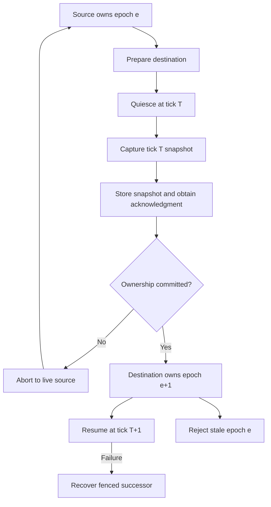

# Simulation, networking and persistence

Planning date: 2026-11-02. Status: proposed architecture awaiting the checkout audit and proof-of-concept gates. No engine code, test results or hardware capability was verified in this workstream. Every performance figure is a proposed acceptance budget. Source paths are candidates until the repository audit maps existing structure. Networking implementation starts at M6; commands, stable IDs and explicit ticks start earlier.

## Recommended decisions

Use one shared C++ simulation library from the offline executable and the later dedicated server. Introduce explicit commands, stable identifiers, simulation ticks and immutable presentation snapshots before the first flight demo. Keep sockets, accounts and PostgreSQL out of the offline dependency graph. Implement them when the miniature game proves their requirements.

Use Jolt for local rigid-body contacts and collision queries. Keep astronomical travel in a separate coordinate/trajectory layer. Use GameNetworkingSockets for encrypted real-time messages, PostgreSQL for durable economic state, and first-party Lua scripts for bounded quests and faction decisions. Each choice is provisional until its integration and representative workload pass the experiments below.

### Technology evidence and version candidates

| Area | Candidate and evidence | Alternatives and decision | Integration gate |
|---|---|---|---|
| Local physics | Jolt 5.6.0, MIT. Exact release exists; archived 5.6 documentation is available. Version-specific Conan page lists 5.6.0 and packages. [S1–S3] | PhysX and Bullet are viable candidates; their official repositories document CPU rigid-body support. Prefer Jolt's documented local-frame approach and focused C++ API, subject to a capital-ship contact test. This is a fit judgment, not a measured performance comparison. [S4–S5] | Compile double-position CPU build on Clang/GCC/MSVC. Disable Jolt GPU compute interfaces for the server. Verify Conan options actually expose required settings. |
| Real-time transport | GameNetworkingSockets 1.6.1, BSD-3-Clause, published 2026-10-03. Conan's generic page lists 1.4.1, while 1.6.1 recipe availability was not verified. [S6–S8] | MsQuic is a maintained QUIC alternative. Prefer GNS's game message API, unreliable delivery and lane control; keep a narrow adapter so a measured transport problem can justify replacement. [S9] | Resolve an audited, pinned 1.6.1 Conan recipe or maintain the minimal internal recipe. Do not silently downgrade to the older package merely to avoid packaging work. |
| Database | PostgreSQL 18.6, PostgreSQL license. Official release notes explicitly date it 2026-08-13 and say 18.5 was never released. PostgreSQL 19 is still presented as a development version in retrieved docs. [S10–S11] | A local file/save adapter is enough for M5. Do not embed an MMO database dependency in the general engine. | Pin image digest and schema migration version; run economic failure tests against the exact server build. |
| Database client | `libpq/17.11` and `libpqxx/8.0.2` are both listed by Conan; libpqxx 8.0.2 packages use C++20. [S12–S13] | Prefer libpqxx on a dedicated persistence worker because RAII transactions reduce hand-written cleanup. Contain exceptions at that worker's boundary. Use direct libpq if later profiling proves asynchronous request volume needs it. | Verify protocol compatibility, TLS, retries and exception conversion with PostgreSQL 18.6. Version numbers need not match between the client library and server. |
| Scripting | Lua 5.5.1, MIT, released 2026-08-03. Conan generic page lists 5.5.0; 5.5.1 availability remains unverified. [S14–S16] | Luau offers gradual typing and sandbox features, but its weekly updates and API differences add another compatibility stream. With modding excluded, choose bounded first-party Lua. Luau is the fallback if authoring experience justifies it. [S17–S19] | Pin source/compiler/bytecode format. Explicitly test Lua error propagation with C++ RAII; C-built Lua uses `longjmp`, and compiling it as C++ uses exceptions. [S20] |

The Jolt generic Conan page still displays 5.2.0 while its version-specific page displays 5.6.0. Do not mistake a stale default web view for absence of a package. Web listings establish candidate availability, not successful resolution or compatible binaries.

For Jolt 5.6, the proposed headless build sets `JPH_USE_DX12=OFF`, `JPH_USE_VK=OFF`, `JPH_USE_MTL=OFF` and `JPH_USE_CPU_COMPUTE=OFF`. These disable optional compute interfaces rather than the core CPU rigid-body solver. Verify the resolved recipe exposes the options and that no graphics dependency remains in the link graph. [S1]

## Module contracts and authority

| Proposed module | Owns | Consumes and produces | Prohibited dependency |
|---|---|---|---|
| `engine/world` | Stable entity IDs, frame IDs, authored/procedural manifests | Typed coordinates, frame transforms, asset references | Vulkan, SQL, network sockets |
| `engine/simulation` | Fixed ticks, validated command application, event order | `CommandBatch -> SimulationStep -> StateDelta/Events` | Window/input devices, real-time wall clock reads inside gameplay logic |
| `engine/physics` | Jolt adapter, body/shape lifetimes, contact/query results | Local-frame SI quantities and generational handles | Galaxy-scale absolute floats, game inventory ownership |
| `game/flight` | Thruster model, flight assists, tactical controller, pilot control | Intent commands -> forces/torques -> ship state | Direct renderer writes, raw network packets |
| `game/economy` | Inventory, production, markets, sinks/sources | Validated economic commands and committed results | Client authority, chain RPC inside simulation |
| `engine/net` | Transport, wire schema, bounds checking, interest replication | Authenticated inputs and snapshots | Vulkan, direct SQL mutations |
| `server/authority` | Region owner, authority epochs, routing and later handoffs | Fenced messages, migration snapshots | Simultaneous writers for the same entity |
| `server/persistence` | Transactions, command receipts, outbox, migrations | Durable command results | Per-frame synchronous DB waits on the simulation thread |
| `engine/script` | VM lifecycle, capabilities, memory/instruction limits | Read views and validated command requests | Raw pointers, sockets, filesystem/process APIs |

An ECS entity index is not a durable identity. Use engine-owned persistent IDs and explicit mappings to ECS handles, physics bodies and wire IDs. Ship modules are gameplay records and hit regions, not automatically separate rigid bodies. Publish read snapshots to render, audio and UI; apply their requests as commands at the next permitted tick boundary.

## Astronomical coordinates and frames

Use SI meters, seconds, radians and kilograms internally. Kilometers, AU and light-years are presentation units. The concrete provisional representation is `GalacticPosition { int64 cell[3]; double localMeters[3]; }`, with cell width `L = 2^32` meters. Normalize each local coordinate into `[-L/2, L/2)` and adjust the corresponding signed cell index with checked arithmetic. This is a proposed serialization contract, pending the precision experiment and ADR acceptance.

Local systems carry a frame ID, frame epoch and CPU double offsets. Never flatten galaxy-scale positions into one global double vector. Compute bounded relative positions on the CPU before converting to local GPU floats; world rendering never requires GPU FP64. Far-field selection works from cells, hierarchical bounds and coarse distances without requesting contact-level precision across the whole galaxy.

A frame records its parent, translation, velocity, orientation policy and epoch. Initially allow translated, nonrotating physics frames; render celestial rotation separately. Any later rotating frame requires correct angular-velocity transforms and fictitious-force handling. Hiding a coordinate change behind a new origin without transforming velocities creates false momentum.

For nonrotating frames, the contract is `p_B = (O_A - O_B) + p_A` and `v_B = (V_A - V_B) + v_A`. Subtract integer cells before converting the bounded relative displacement to floating point, check subtraction/normalization bounds, and reject invalid coordinates. Record seeded random streams per system and stable command/event order so scheduling changes do not silently change gameplay outcomes.

At an origin shift or frame transfer, perform one tick-boundary transaction: transform positions and velocities; preserve global trajectory; update physics proxies, constraints and query offsets; transform previous and current render snapshots; update prediction history and temporal-render history; increment the frame epoch. A consumer must never combine a pose from one epoch with an origin from another. Collision queries carry an explicit frame and use an origin near the expected hit.

Jolt's documented limits matter: its broadphase, velocities and rotations retain float precision even in double-position mode. Its documentation recommends keeping local positions and velocities small, and using multiple `PhysicsSystem` instances for space simulation. The documented ordinary dynamic-body range is approximately 0.1–10 meters and 0–500 m/s. Capital ships are outside that ordinary range, so double positions alone do not validate them. [S2]

Keep every interacting contact group inside one physics domain. Do not split two touching ships between unrelated simulations. Merge or transfer domains at a barrier; ghost proxies can support queries but never issue authoritative impulses or damage. Treat warp as a server-authored parametric trajectory with explicit entry, committed transit and exit states. It does not integrate an AU-scale rigid body through every obstacle. Stream the destination and collision data before exit; delay the exit safely if required content or authority is unavailable. Seamless presentation is the goal, but a loading-free guarantee cannot cover arbitrary storage or network failure.

## Flight and combat

Both direct flight and tactical navigation feed the same intent/force model. Direct control supplies thrust and attitude intent. Tactical control supplies destination, orbit or velocity goals that the controller converts to constrained forces. Switching modes preserves position, velocity and angular momentum. Ship performance limits come from thruster capability, mass, power and game rules. Assisted braking is an explicit opposing force, not an unexplained reset of velocity.

For M3, simulate the controlled ship at 60 fixed steps per simulation second and interpolate presentation independently. For the multiplayer proposal, evaluate a 30 Hz authoritative tick with two 60 Hz physics substeps. Confirm the rates through collision and prediction tests before treating them as a release contract. Run AI planning and distant-world decisions at lower independent cadences; preserve one ordered command application phase.

Model a spacecraft with one rigid hull or a small compound collision representation. Components have health, attachment transforms and hit proxies. Introduce detached rigid fragments only when visible and gameplay-relevant, with a bounded lifetime/count. This avoids turning each fitted item into a constraint solver workload. Large capitals may require a specialized collision representation; decide from the scale PoC rather than committing to a full articulated hull.

Targeted weapons use validated target/range/line-of-sight rules. Projectile weapons use server-owned trajectories and continuous sweeps at their supported speeds. The client can predict effects, but cannot award damage or select authoritative hits. Keep projectile capacity separate from ship and drone capacity. Cosmetic tracers and particles are separate from damaging projectiles. A declared saturation rule must reject or coalesce visual work without silently dropping already accepted damaging shots.

Pilot control is a versioned server-owned lease on one controllable vessel. A switch command validates ownership, range/link rules and entity availability. Pre-subscribe likely fighter targets so a camera switch can appear immediate; confirm authority on acknowledgment. A networked switch cannot promise instantaneous server acknowledgment across nonzero latency.

## Prediction, reconciliation and replication

Use snapshot authority with prediction of the locally controlled ship. Re-run unacknowledged flight inputs after receiving its authoritative state. Do not make the MMO depend on exact cross-platform replay of every Jolt contact. Jolt documents conditions for determinism, including build flags and operation order; broadphase queries have additional caveats. Deterministic local tests are valuable, but not a substitute for reconciliation. [S2]

Every input contains protocol/schema version, input sequence, expected control version, estimated simulation tick and bounded intent values. The server derives identity from the authenticated connection, validates rate/time windows, and rejects replayed or impossible commands. Snapshot headers include authority epoch, frame epoch, simulation tick, active time scale, baseline ID and the last input acknowledged. Missing baselines trigger an explicit refresh. Malformed lengths, NaNs, unknown IDs and excessive nesting fail before allocation.

GNS documents encrypted packets, reliable/unreliable messages and priority lanes; it does not supply entity serialization, delta compression, game authentication or general access to Steam relay services. [S6] Plan separate traffic classes: unreliable sequenced inputs/snapshots, reliable lifecycle/control changes, and reliable low-priority social/transaction receipts. Bulk assets use the asset channel/cache and cannot stall gameplay. Require authenticated server identity and short-lived account session credentials from the control plane; transport encryption alone does not prove account identity.

Interest management begins with spatial cells plus ownership, sensors, combat and event relevance. Schedule updates by relevance and a per-client byte budget. Always send the controlled ship and immediate threats; distant entities receive lower-rate summaries. Replicate a projectile's spawn/trajectory/correction when sufficient, rather than its full transform every network tick. A simple arithmetic example demonstrates the need: 200 visible entities × 80 bytes × 20 snapshots/s is 320 kB/s per client before headers; sending that independently to 200 clients is 64 MB/s. This is a bandwidth estimate, not a measured protocol size.

For M6, test 32 clients before scaling to hundreds. Proposed acceptance: 150 ms RTT, 30 ms jitter, 2% loss and deliberate reordering for 30 minutes; no crash, duplicate action, ownership violation or permanent desynchronization. On the defined free-flight trace, aim for p95 correction below 0.5 m at ≤100 m/s after warmup. Report collision corrections separately. Measure p50/p95/p99 latency and bytes; never hide poor tail behavior behind average FPS.

## Persistence, inventory and the offline economy

Persist durable business facts, not every rendered frame. Separate high-frequency transient pose state, periodic world checkpoints and economic transactions. A client receives a successful trade/reward receipt only after commit. Database unavailability can leave flight operational under a documented policy, but must suspend transfers, rewards, salvage ownership and other durable value mutations.

Each durable command has a unique operation ID, actor, request digest and stored result. Retrying the same ID returns the committed result; reusing it for different parameters is rejected. Within one SQL transaction, validate ownership/version, reserve resources, apply inventory/currency changes, write the command receipt and insert an outbox event. Deliver the outbox after commit and tolerate duplicate delivery. This gives one business effect through idempotency; it does not claim exactly-once message transport.

Use integer minor units with checked bounds for currency and quantities. Ledger entries balance per currency and operation. Enforce cross-row balance using the transactional write API and appropriate deferred validation; a row `CHECK` alone cannot prove that all ledger rows sum to zero. Inventory transfers, orders and escrow reference unique item/stack identities. Treat minting, destruction and administrative compensation as separately authorized, auditable operations. Never edit committed history to disguise a repair.

Start with explicit row locking and consistent lock order for simple transfers, or SERIALIZABLE transactions for multi-row invariants. Either approach needs a documented proof of the invariant. PostgreSQL warns that serializable transactions can fail and the entire transaction must be retried. Bound retries and surface overload instead of infinite contention loops. [S21]

Ship death is an idempotent operation: mark the ship destroyed, move eligible cargo into one wreck inventory, consume destroyed resources, and assign salvage eligibility once. While durable death resolution is pending, lock the affected ship and loot against control, salvage, transfer or resale; database failure cannot expose both the intact ship and its wreck cargo. Starter-ship recovery has an idempotent entitlement and restrictions against manufacturing free sellable value by repeated self-destruction. Test destruction, docking, salvaging, trading and disconnects at the same tick boundary.

Offline production uses persisted jobs and resource reservations. A completion is a compare-and-set transition with an operation ID, not a loop replaying every missed frame. Compute bounded catch-up from elapsed time and capacity limits; preserve stockpile, power, logistics and input constraints. NPC faction activity starts as coarse strategic state and scheduled plans. Detailed entities instantiate from the same reserved resources when players approach, and collapse back to strategic records without duplicating inventories or missions.

M7 includes a minimal durable NPC territory transition with one ownership/version invariant. M8 adds player territorial events and permission rules on that transition boundary. This lets M7 test NPC expansion and territorial loss without depending on an unimplemented player-conquest system.

World recovery needs explicit durability classes. Proposed initial targets: no acknowledged economic transaction loss on a single process crash; transient pose recovery from the latest checkpoint; ship destruction/loot outcome committed before it is acknowledged as durable. A single disk or asynchronously replicated database cannot promise zero loss after machine/site destruction. PostgreSQL documents that asynchronous replication permits a failover loss window. Before public real-value transfers, select a stronger durability topology and prove restoration and reconciliation. [S22]

## Regional time dilation and distributed ownership

Define three clocks: monotonic wall time for transport/auth/leases; region simulation time for movement, weapons, repair, mining and combat effects; durable economy time for explicitly real-time scheduled industry. UTC is for durable timestamps and display; elapsed-time loops use monotonic time. Define boundary rules so a time-dilated battle cannot generate accelerated repairs, mining or reinforcements by mixing clocks.

Durable scheduling needs a restart policy because a process monotonic clock does not survive restart. Record committed progress and authoritative timestamps; clamp negative elapsed values and cap catch-up after large clock jumps. Alert on clock disagreement instead of silently issuing extra production.

Implement dilation by advancing a fixed simulation step less often in wall time. At a 30 Hz base tick, scale 0.5 advances 15 ticks per wall second while each advances 1/30 simulation second. Merely reducing `dt` while still running 30 full updates per wall second does not relieve CPU load. Clients interpolate the announced simulation clock; heartbeat and admission controls remain responsive. Apply hysteresis to transitions and show the active scale. CCP's published explanation establishes time dilation as an ordered workload response; NGEN's exact schedule is a proposed design. [S23]

Compare equal-simulation-time results only in a closed region fixture with identical tick-indexed commands, random streams and controlled external economy events. Real-time manufacturing legitimately advances further during a longer wall-time battle. Test manufacturing, transfers and reinforcement admission separately for clock-boundary fairness; do not require the entire economy to match across different elapsed wall times.

Move tightly interacting ships together under one authority/time scale. Cross-region trades go through the durable economy. Combat interaction across different scales requires a shared domain or explicit prohibited boundary, not two contradictory clocks. Minimum dilation cannot rescue arbitrary per-tick work; use admission control, bounded spawned objects and measured degradation policies when a domain still exceeds capacity.

M6–M9 should begin with one authoritative process owning multiple local domains. M10 introduces region ownership records and monotonically increasing authority epochs. At any instant, an entity has at most one valid writer across all epochs. A lease timeout alone cannot stop an old process after a long pause. Every persistence write and inter-authority message must carry a fencing epoch that the receiver validates. Validate the epoch atomically with the protected mutation; checking it earlier and committing later leaves a race. After ownership changes, an old-epoch mutation must fail at that boundary. The Chubby paper documents sequencers for this stale-owner problem. [S24]

Migration protocol: prepare destination resources; establish transfer ID and source epoch; quiesce the source at the end of tick T; resolve or durably record in-flight economic operations; capture a versioned snapshot with pending intents, in-flight operation state, event sequences and control leases; verify its tick/schema/hash and obtain acknowledgment of durable storage from the destination or transfer store; atomically advance ownership/epoch in the authoritative registry with a reference to that snapshot; destination resumes from T+1; source forwards/rejects stale requests. Snapshot durability must cover the declared failure domain before ownership commits. The source cannot advance after the captured tick. Before ownership commit, abort to the live source; after commit, recovery proceeds from the recorded snapshot under the destination or a new fenced successor. Test crashes, partition and replay at every transition.

The following diagram describes the ownership decision, not a distributed implementation to build early.

A source crash before the commit still requires registry-mediated recovery; the abort path assumes the original owner remains alive and fenced correctly.

Scaling from hundreds to thousands must distinguish total connected population, active regions, local battle density, replication recipients and DB write rate. Adding servers helps independent regions. It does not automatically divide one dense interacting battle. Five-figure concurrency remains a capacity objective until a measured topology, workload and operating budget establish it.

## First-party scripting boundary

Scripts handle quest sequencing, dialogue conditions, faction priorities and slow decisions. C++ owns physics, network validation, inventory and ledger invariants. Give scripts read-only snapshots and narrow capability functions that enqueue commands. No raw ECS/Jolt pointers or SQL handles. Pin script package and schema versions in saved state, then migrate explicit quest data when scripts change; never serialize VM stacks as long-term truth.

Use VM-level memory caps, instruction quotas, bounded native calls and a watchdog. Start with a proposed 16 MiB VM cap and a 1 ms scripting allowance per 30 Hz region tick, then profile the authored content and revise the explicit budget if needed. A timeout inside a blocking native function is not solved by an interpreter hook. Disable filesystem, process, arbitrary native loading, debug mutation and host-time/RNG access; provide controlled clock/RNG functions. Accept compiled script assets only from the trusted build pipeline. With modding excluded, there is no player code upload path.

Select one Lua error strategy and test it. C-built Lua can jump past C++ objects if bindings are careless. Either keep C trampolines free of nontrivial live objects across error-raising calls, or compile Lua as C++ and contain all errors inside a scripting adapter. Do not globally disable C++ exceptions and assume ordinary Lua C++ bindings remain safe. [S20]

## Ranked experiments and objective gates

| Priority / stage | Experiment | Pass evidence; failure response |
|---|---|---|
| P0, M1/M3 | CPU-only Jolt build and server dependency separation | Link/runtime dependency report contains no Vulkan, windowing or GPU-compute dependency for the headless target. If dependencies leak, correct CMake target edges before gameplay grows. |
| P0, M3/M4 | Precision, large ships and relative velocity | Test 10 m, 100 m and 1 km hulls, near-contact docking, high relative speed, 10,000 origin transfers and system-distance travel. Proposed coordinate residual ≤1 mm and velocity residual ≤0.1 mm/s for the analytic frame-transform tests. Physical contact thresholds must be defined per hull scale. If contacts fail, change collision representation/supported dimensions, not just precision flags. |
| P0, M6 | Prediction and adverse network conditions | Seeded 30-minute trace at stated RTT/jitter/loss; report correction tails and wire bytes, zero duplicate actions or stale-control acceptance. Correct reconciliation/model before increasing player count. |
| P0, M7 | Economic crash/retry invariants | One million commands grouped into seeded sequences, including concurrent transfer, order-fill, destruction and production races; kill before/after commit and outbox delivery. Every acknowledged command reconstructs once; no negative balances, missing items or unbalanced operations. |
| P1, M5 | Script resource and error containment | Inject runaway loops, allocation failure, malformed script assets and failing native calls. The VM stops the task within its declared quota, preserves RAII cleanup, and leaves no partial economic effect. |
| P1, M7/M8 | Dormant/active conversion and griefing | Repeatedly instantiate/collapse the same industry/fleet; conserve cargo, jobs and mission identities. Test ramming, pushing a neutral ship into an asteroid, explosive cargo, drone ownership changes and event entry/exit. |
| P1, M9 | Fleet benchmark with declared extra load | Starting fixture: 200 equipped AI ships, 800 active drones/fighters, 10,000 concurrent damaging projectiles, 5,000 static collision shapes. Pin ship mixes, guns/rates, hull dimensions and contact density. Proposed dedicated-host p99 tick ≤25 ms at 30 Hz for 30 minutes, bounded memory and zero capacity drops of accepted damage events. Record CPU model/core quota before claiming any pass. |
| P1, M9 | Time dilation fairness | At scales 1, 0.5 and 0.25, a closed fixture with identical tick-indexed commands, RNG and controlled external events produces equivalent regional state at equal simulation time within declared tolerance. Separately test wall-time manufacturing, transfers and reinforcement fairness. Verify CPU cost/wall-second falls. |
| P2, M10 | Fenced migration and recovery | At least 10,000 scripted transfers with process kills, delayed old-owner messages and network partitions; at most one valid writer per entity across all epochs, old-epoch rejection atomic with mutation, and zero duplicate inventory/reward effects. Recover the recorded payload after a post-commit source failure. |

PvP protection must reject unauthorized damage before applying it. Track causal ownership through missiles, drones, debris, tractor forces and secondary explosions. Event membership and combat permissions are versioned server facts, rechecked at the rule-defined impact boundary. Attribution helps investigation, but cannot reliably infer intent from every collision. If indirect neutral-player harm cannot be prevented for a mechanic, constrain that mechanic outside authorized events. No algorithm can promise both unrestricted environmental lethality and complete prevention of environmental griefing.

## Suggested ADRs and milestone task boundaries

- M1: simulation core has no presentation/service dependencies; stable IDs and explicit time types; one command boundary; a disposable CPU-only physics packaging probe if needed to resolve the dependency boundary, with the production Jolt adapter deferred to M3.
- M3: direct/tactical intent contract; fixed-step flight; local physics and bounded body model; local prediction-friendly input trace format.
- M4: integer-cell/double-offset coordinates; frame epochs and velocity transforms; committed warp/streaming state machine.
- M5: idempotent local economic command model and save schema; modular damage/wreck state; bounded first-party scripting.
- M6: authoritative snapshots with local flight prediction; GNS transport/auth contract; interest budget and saturation rules.
- M7: PostgreSQL transaction/outbox model; recovery durability classes; scheduled industry and dormant/active conservation.
- M8: event permission state machine and indirect-damage policy, including clear fail-closed behavior.
- M9: explicit benchmark fixture and regional time domains; no unspecified '200 ships' performance claim.
- M10: single-writer regions, monotonic epochs and fenced handoff; no speculative distributed implementation before local capacity measurements.

Each bullet should become a distinct small planning/implementation task with its own fixture, evidence file and reviewer. Preserve the project's branch, signing and PR policies when implementation is separately authorized.

## Primary-source register

Sources establish library capabilities, published limits and release/package evidence. The architecture, capacity budgets and acceptance criteria are NGEN proposals; vendor performance claims do not establish NGEN performance.

- S1. [Jolt 5.6.0 release](https://github.com/jrouwe/JoltPhysics/releases/tag/v5.6.0). Adds optional compute interfaces; no NGEN speed claim inferred.
- S2. [Archived Jolt 5.6 architecture](https://jrouwe.github.io/JoltPhysicsDocs/5.6.0/). Space/precision/scale and determinism limits.
- S3. [Conan Jolt 5.6.0 recipe](https://conan.io/center/recipes/joltphysics?version=5.6.0). Packages listed; not locally installed.
- S4. [PhysX official repository](https://github.com/NVIDIA-Omniverse/PhysX); [rigid-body documentation](https://nvidia-omniverse.github.io/PhysX/physx/5.6.1/docs/RigidBodyDynamics.html).
- S5. [Bullet official repository](https://github.com/bulletphysics/bullet3).
- S6. [GNS README](https://github.com/ValveSoftware/GameNetworkingSockets).
- S7. [GNS 1.6.1 release](https://github.com/ValveSoftware/GameNetworkingSockets/releases/tag/v1.6.1). [Release API](https://api.github.com/repos/ValveSoftware/GameNetworkingSockets/releases/tags/v1.6.1) confirms a non-prerelease publication timestamp of `2026-10-03T01:28:05Z`.
- S8. [Conan GNS recipe](https://conan.io/center/recipes/gamenetworkingsockets).
- S9. [MsQuic official repository](https://github.com/microsoft/msquic).
- S10. [PostgreSQL 18.6 release notes](https://www.postgresql.org/docs/release/18.6/); dated 2026-08-13.
- S11. [PostgreSQL version policy](https://www.postgresql.org/support/versioning/).
- S12. [Conan libpq](https://conan.io/center/recipes/libpq).
- S13. [Conan libpqxx](https://conan.io/center/recipes/libpqxx).
- S14. [Lua official news](https://www.lua.org/news.html); dated 5.5.1 release.
- S15. [Lua license](https://www.lua.org/license.html).
- S16. [Conan Lua](https://conan.io/center/recipes/lua).
- S17. [Luau sandbox](https://luau.org/sandbox/).
- S18. [Luau releases](https://github.com/luau-lang/luau/releases); 0.745 visible, October 30, year not exposed.
- S19. [Conan Luau](https://conan.io/center/recipes/luau); 0.700 listed.
- S20. [Lua 5.5 manual, C error handling](https://www.lua.org/manual/5.5/manual.html).
- S21. [PostgreSQL 18 transaction isolation](https://www.postgresql.org/docs/18/transaction-iso.html).
- S22. [PostgreSQL standby replication](https://www.postgresql.org/docs/current/warm-standby.html).
- S23. [CCP on time dilation](https://www.eveonline.com/fr/news/view/observing-the-burn-jita-player-event).
- S24. [Mike Burrows, The Chubby lock service for loosely-coupled distributed systems, OSDI 2006](https://research.google.com/archive/chubby-osdi06.pdf). Publisher metadata date in search is not the paper's publication date.
