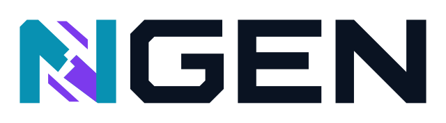

<p align="center"><picture><source media="(prefers-color-scheme: dark)" srcset="https://raw.githubusercontent.com/kyaulabs/ngen/v0.6.0/brand/logos/png/ngen-wordmark-dark-640.png"></picture></p>

## ✨ Highlights

NGEN 0.6.0 adds an owner-thread headless warp journey. The pilot must qualify
for the authored route and may cancel before commitment. Transit advances on
fixed ticks in split coordinates, without a local contact body. Arrival waits
for matching prepared collision data and a clear berth, then resumes ordinary
Jolt flight with the same logical vessel, mass and tick. Repeated arrival
requests cannot replace the existing body.

This is one scoped, stationary-entry route. The interactive demo has no warp
command. Streaming, arbitrary contact-group transfers and network authority
are not part of this release. Existing flight, motion vectors and SDK startup
remain available.

## 📦 Downloads

This release contains **source and checksums only**, not a playable download.
It includes no private scenes, credentials, executables, installers or recordings.
GitHub's automatic source archives are separate from the verified payload:

| File | Purpose |
|---|---|
| `ngen-0.6.0-source.tar.gz` | Reviewed source, public fixtures, build inputs and notices |
| `ngen-0.6.0-source.tar.gz.sha256` | SHA-256 checksum for the source archive |
| `ngen-0.6.0-SHA256SUMS` | Complete release checksum inventory |

Checksums check integrity, not publisher identity. The annotated tag identifies
the signed promotion merge and is not separately GPG-signed.

## 🛠️ Get started

From a fresh directory containing the downloaded source archive and checksum:

```sh
sha256sum -c ngen-0.6.0-source.tar.gz.sha256
tar -xzf ngen-0.6.0-source.tar.gz
cd ngen-0.6.0
```

Or clone the tagged source:

```sh
git clone --branch v0.6.0 --depth 1 https://github.com/kyaulabs/ngen.git
cd ngen
```

The primary profile needs Linux x86-64, Clang 23.1.4, Python 3.11+, Conan 2.34.0,
CMake 4.4.5, Ninja 1.13.2 and standard native build tools. Initial dependency
preparation needs network access. The CPU harness and travel tests require no
window, GPU or service.

```sh
python3 -m venv .venv
. .venv/bin/activate
python -m pip install 'conan==2.34.0' 'cmake==4.4.5' 'ninja==1.13.2'
clang++ --version
sh tools/prepare.sh release
cmake --preset release -DNGEN_INSTALL_SDK=ON
cmake --build --preset release
ctest --preset release --output-on-failure --no-tests=error
./build/release/sim_harness
```

Run the headless warp and destination-contact fixture:

```sh
sh tools/prepare.sh flight-release
cmake --preset flight-release
cmake --build --preset flight-release
ctest --preset flight-release -R '^travel$' --output-on-failure --no-tests=error
```

## 📚 Documentation

- [Overview and startup](https://github.com/kyaulabs/ngen/blob/v0.6.0/README.md)
- [Bounded warp contract and evidence](https://github.com/kyaulabs/ngen/blob/v0.6.0/docs/evidence/M4/bounded-warp.md)
- [Source-built SDK](https://github.com/kyaulabs/ngen/blob/v0.6.0/docs/creator-sdk.md) and [scene walkthrough](https://github.com/kyaulabs/ngen/blob/v0.6.0/docs/creator-scene.md)
- [Execution order](https://github.com/kyaulabs/ngen/blob/v0.6.0/docs/planning/execution-order.md)
- [Source and dependency notices](https://github.com/kyaulabs/ngen/tree/v0.6.0/licenses)

Additional tutorials and API reference are forthcoming. Existing AGPL and
separate dependency notices remain. Supplied commercial typefaces are not
relicensed as AGPL; there is no proprietary-game exception.

## ✅ Verification

[PR #106](https://github.com/kyaulabs/ngen/pull/106) integrated the bounded warp.
The headless fixture crossed about 1.03 AU, delayed arrival without a local body,
preserved the 1,200 kg vessel and session tick, rejected replay, and exercised a
real contact after arrival. Clang Release, GCC Debug and strict sanitizer
headless graphs passed 9/9 each; the Release demo graph passed 28/28. No graphical
warp, new performance budget or Windows runtime claim is made.
